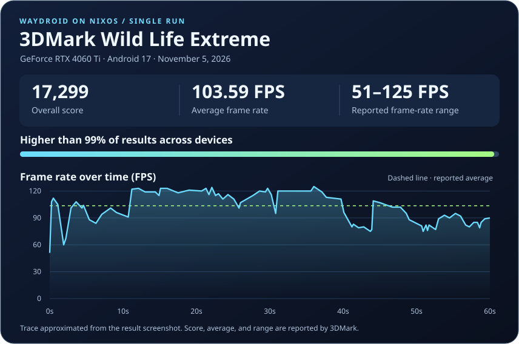

# waydroid-a17-nvidia-nix

> [!WARNING]
> This project is completely vibeslopped. I have no fucking clue how it works at all so PLEASE be cautious before using it. This was intended only for me. It's a vibeslop fork of a vibeslop fork of a vibeslopped project lmao.

Run Android 17 (LineageOS 24.0) in Waydroid with NVIDIA GPU acceleration. This fork packages the upstream NVIDIA integration as an x86_64 NixOS flake.


## Install on NixOS from scratch

Start with an x86_64 NixOS machine, a Wayland desktop session, and an NVIDIA GPU supported by NVIDIA’s open kernel modules. You need sudo access and an internet connection for the Nix build and Android downloads. The module supplies Waydroid, LXC, and the NVIDIA vendor package. KernelSU is optional and requires separate host kernel setup.

### 1. Add the module to your system flake

If you already manage NixOS with a flake, keep your current nixpkgs input and host modules. Add the `waydroid-a17-nvidia-nix` input, make it available to your `outputs` function, and add the module and its enable option as shown below.

If your system still uses a plain `configuration.nix`, create `/etc/nixos/flake.nix` with this example. Keep your existing `configuration.nix` and its hardware imports. Replace `my-host` with the name you want to use in `nixosConfigurations`. This example uses the fork’s pinned nixpkgs.

```nix
{
  inputs = {
    waydroid-a17-nvidia-nix.url = "github:ariaofdelusion/waydroid-a17-nvidia-nix";
    nixpkgs.follows = "waydroid-a17-nvidia-nix/nixpkgs";
  };

  outputs = { nixpkgs, waydroid-a17-nvidia-nix, ... }: {
    nixosConfigurations.my-host = nixpkgs.lib.nixosSystem {
      modules = [
        ./configuration.nix
        waydroid-a17-nvidia-nix.nixosModules.default
        {
          virtualisation.waydroid-a17-nvidia-nix.enable = true;
          nix.settings.experimental-features = [ "nix-command" "flakes" ];
        }
      ];
    };
  };
}
```

### 2. Configure NVIDIA and activate the system

For a desktop using NVIDIA as its primary GPU, add or merge these settings into your host configuration. On a hybrid laptop, use the appropriate PRIME configuration alongside the open module and modesetting settings. See the [NixOS NVIDIA guide](https://wiki.nixos.org/wiki/NVIDIA).

```nix
{
  nixpkgs.config.allowUnfree = true;
  hardware.graphics.enable = true;
  services.xserver.videoDrivers = [ "nvidia" ];
  hardware.nvidia.open = true;
  hardware.nvidia.modesetting.enable = true;
}
```

If your system flake lives in Git, stage any new Nix files first. Replace `/etc/nixos` and `my-host` with your flake directory and configuration name. The flags also enable flakes for the first activation on a system where they were previously disabled.

```sh
sudo nixos-rebuild switch --extra-experimental-features 'nix-command flakes' --flake /etc/nixos#my-host
```

If you changed the NVIDIA driver or kernel, reboot before continuing. Log into a Wayland session. `echo "$XDG_SESSION_TYPE"` should print `wayland`, and `cat /sys/module/nvidia_drm/parameters/modeset` should print `Y`.

### 3. Download the Android images

Get two ZIPs from the [WayDroid-ATV Android 17 release](https://github.com/WayDroid-ATV/waydroid-builds/releases/tag/20261017). Download one system ZIP and the MAINLINE vendor ZIP. The initial vendor image lets Waydroid initialize before the setup helper installs the packaged NVIDIA vendor image.

| Image | Filename |
| --- | --- |
| System without Google apps | `lineage-24.0-20261017-VANILLA-waydroid_x86_64-system.zip` |
| System with Google apps | `lineage-24.0-20261017-GAPPS-waydroid_x86_64-system.zip` |
| Vendor, required for either system image | `lineage-24.0-20261017-MAINLINE-waydroid_x86_64-vendor.zip` |

### 4. Extract the images and initialize Waydroid

Open Bash in the directory containing both ZIPs. If you downloaded the GAPPS image, change `VANILLA` to `GAPPS` in the first line. If migrating an existing install, back up `/var/lib/waydroid` and any preinstalled images before switching Android versions, then use `sudo waydroid init -f` in the last line.

```bash
system_zip=lineage-24.0-20261017-VANILLA-waydroid_x86_64-system.zip
vendor_zip=lineage-24.0-20261017-MAINLINE-waydroid_x86_64-vendor.zip
bsdtar=$(nix build --no-link --print-out-paths nixpkgs#libarchive)/bin/bsdtar

sudo install -d /etc/waydroid-extra/images
sudo "$bsdtar" -xf "$system_zip" -C /etc/waydroid-extra/images system.img
sudo "$bsdtar" -xf "$vendor_zip" -C /etc/waydroid-extra/images vendor.img
sudo waydroid init
```

### 5. Install the NVIDIA vendor image and launch Android

```sh
sudo waydroid-nvidia-setup
```

The helper checks the packaged image against your GPU and loaded driver, saves the initial vendor image, and starts the container service. Wait for setup to succeed. Then start your session as your desktop user:

```sh
waydroid session start
```

Once the session reports that Android is ready, open the UI from another terminal:

```sh
waydroid show-full-ui
```

To restore the original vendor image, run `sudo waydroid-nvidia-setup --restore-official-vendor`.

## Update an existing installation

From the directory containing your **NixOS system flake**, update the Waydroid input and activate the new configuration. Replace `my-host` with your configuration name, and use your own input name if it differs from the install example. If the flake directory is root-owned, run the lock-file update with `sudo` too.

```sh
nix flake update waydroid-a17-nvidia-nix
sudo nixos-rebuild switch --flake .#my-host
```

If the update also changes your kernel or NVIDIA driver, boot into the new generation first. Save any open Android work, then run the setup helper again so it can check the loaded driver and refresh the container configuration. Your existing Android images and app data carry over.

```sh
waydroid session stop
sudo waydroid-nvidia-setup
waydroid show-full-ui
```

## Performance on NixOS



Single run on an RTX 4060 Ti with NVIDIA driver `615.78.08`, NixOS 26.11, kernel `7.3.1-cachyos`, KDE Wayland, and Android 17 GAPPS. The frame-rate trace is approximate. The screenshot reports Wild Life Extreme without specifying Unlimited mode.

## About this fork

The module uses NixOS’s Waydroid service with the upstream patched host package and matching vendor image. Upstream’s NVIDIA stack provides Vulkan and GLES through NVK, plus hardware video decoding and encoding through NVDEC and NVENC. Android boot and hardware rendering were verified on the machine above.

GPT 6.1 Sol built the NixOS port. The original project and its contributors built the Android and NVIDIA integration. See the [upstream project](https://github.com/cagedbird043/waydroid-a17-nvidia) for Arch Linux instructions, screenshots, benchmarks, and full acknowledgements.
